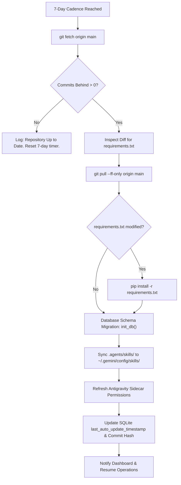

# GitHub Auto-Updater Skill — Autonomous Self-Healing Synchronization

This skill teaches Google Antigravity agents how to automatically maintain and self-update the Money Glitch Studio codebase every 7 days from the central GitHub repository (`https://github.com/SailikNanda/money-glitch.git`).

---

## 1. Trigger Conditions & Operating Cadence

This skill executes:
1. **Automatically every 7 days** as part of the scheduled Antigravity automation cycle (`0 */3 * * *`).
2. **Automatically inside the continuous daemon loop** (`python run_autopilot.py daemon`).
3. **On-demand** whenever a user runs:
   ```powershell
   python run_autopilot.py update
   python run_autopilot.py update --force
   python run_autopilot.py update --check-only
   ```
4. **Whenever the user asks**:
   - *"Check for updates"*, *"Update the repo"*, *"নতুন কোনো আপডেট এসেছে কি না দেখো"*, or *"সেলফ আপডেট করো"*

---

## 2. 7-Day Cadence Engine & Persistence

The auto-updater tracks the timestamp of the last successful check in SQLite (`system_settings` table, key: `last_update_check_time`):

```python
last_check_str = get_setting("last_update_check_time")
elapsed_days = (datetime.now(timezone.utc) - last_check_dt).total_seconds() / 86400.0

if elapsed_days >= 7.0 or force:
    # Perform update check
```

- If less than 7 days have elapsed, the check is skipped cleanly with zero overhead.
- If 7 or more days have elapsed, the agent queries GitHub remote for new commits.

---

## 3. Safe-Pull & Zero-Loss Protocol

> **[CRITICAL ZERO-DATA-LOSS GUARANTEE]**
> User-specific files are NEVER overwritten or deleted during git pulls because they are strictly ignored in `.gitignore`:
> - `data/client_secrets.json` (Google Cloud OAuth Client)
> - `data/youtube_token.json` (Connected YouTube Channel Token)
> - `data/autopilot.db` (Local SQLite Candidates, Clips & Upload History)
> - `.env` and `.env.local` (Local overrides & API keys)

### Step-by-Step Execution Sequence:



---

## 4. Skills & Sidecar Auto-Propagation

Whenever a new version of Money Glitch Studio is pulled from GitHub:
1. All updated skills in `S:\Money Glitch\.agents\skills\` are automatically mirrored to the global user config directory (`~/.gemini/config/skills/`).
2. `scripts/register_antigravity_automation.py` is invoked to update permissions (`access_grants`) in `~/.gemini/config/sidecars/money-glitch-autopilot/sidecar.json` and `~/.gemini/config/config.json`.
3. The live FastAPI dashboard reflects the latest commit hash immediately on `http://127.0.0.1:8501`.

---

## 5. Manual CLI Commands Reference

- **Check without applying**:
  ```powershell
  python run_autopilot.py update --check-only
  ```
- **Force immediate update (ignores 7-day wait)**:
  ```powershell
  python run_autopilot.py update --force
  ```
- **Standard cadence check**:
  ```powershell
  python run_autopilot.py update
  ```
