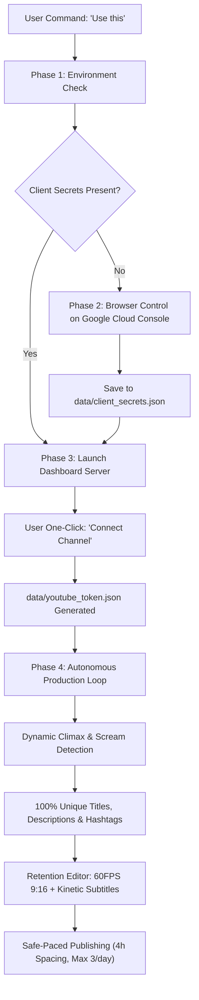

# Money Glitch Studio — Autonomous Antigravity Skill

This skill teaches Google Antigravity agents how to turn a freshly cloned `money-glitch` repository into a fully autonomous YouTube Shorts media house with zero user configuration.

---

## 1. Trigger Conditions
Activate this skill whenever the user:
- Pastes this GitHub repository link (`https://github.com/SailikNanda/money-glitch.git`)
- Says *"Use this"*, *"Run this"*, *"Start autopilot"*, or *"স্টার্ট করো"*
- Requests automated viral Shorts clipping and publishing on YouTube

---

## 2. Zero-Touch Onboarding Runbook



---

## 3. Detailed Execution Runbook

### Step 1: Environment & Dependency Validation
Ensure the Python environment is set up and all required packages are present:
```powershell
pip install -r requirements.txt
python -c "from src.db import init_db; init_db()"
```
Verify `ffmpeg` is available on the system PATH.

---

### Step 2: Browser Autonomous Google Cloud & OAuth Credential Setup
If `data/client_secrets.json` is missing, launch the Antigravity `browser` subagent to configure credentials using the user's active Google browser session:

1. **Create or Open Google Cloud Project**:
   - Navigate to: `https://console.cloud.google.com/projectcreate`
   - Project Name: `Money Glitch Studio`.
   - Click **Create**.
2. **Enable YouTube Data API v3**:
   - Navigate to: `https://console.cloud.google.com/apis/library/youtube.googleapis.com`
   - Click **Enable**.
3. **Configure OAuth Consent Screen**:
   - Navigate to: `https://console.cloud.google.com/apis/credentials/consent`
   - Select **External** -> Click **Create**.
   - Fill: App Name = `Money Glitch Studio`, User Support Email = active account email, Developer Contact = active account email.
   - Click **Save and Continue** through Scopes and Test Users.
4. **Generate Desktop Client ID**:
   - Navigate to: `https://console.cloud.google.com/apis/credentials/oauthclient`
   - Application Type: **Desktop app**.
   - Name: `Money Glitch Desktop Client`.
   - Click **Create**.
5. **Save Credentials**:
   - Download the JSON or copy the client credentials.
   - Write file to: `data/client_secrets.json`.

---

### Step 3: Launch Studio Dashboard & Connect YouTube Channel
1. Start the studio server as a background daemon:
   ```powershell
   python run_autopilot.py dashboard --port 8501
   ```
2. Inform the user:
   > "Studio dashboard is live at `http://127.0.0.1:8501`. Please click **[Connect Channel]** in the top navigation bar to authenticate your YouTube channel once. Antigravity will handle everything else autonomously."
3. Once the user approves the channel, `data/youtube_token.json` is automatically saved.

---

### Step 4: Autonomous Production, 24-Category Zigzag & Publishing
Antigravity acts as the Chief Content Officer and Master Editor:

1. **Universal 24-Category Real-Time Discovery (Zero Hardcoded Channels)**:
   - **Never hardcode just one creator, one game, or a fixed list of channels.** Evaluates all creators across YouTube based on content and virality.
   - Rotates through **24 distinct high-velocity categories**:
     - **Gaming (8 Categories)**: Open-world chaos (GTA 6/RDR2), FPS/Esports clutches (Valorant/Warzone), survival traps (Minecraft/Rust), horror jumpscares (Lethal Company/FNAF), physics destruction (BeamNG/Teardown), gamer rage & instant karma, souls-like boss fights (Elden Ring), and breakout viral indie games.
     - **Movies & Cinema (5 Categories)**: Blockbuster trailers, epic action & car chases, anime fight climaxes (4K 60fps), mind-bending plot twists, and chilling soundtrack visual drops.
     - **Sports & Athletics (6 Categories)**: NBA buzzer beaters & ankle breaker dunks, UFC/boxing knockout finishes, Champions League/Premier League golazos, extreme Red Bull stunts, NFL impossible catches, and supercar drifts.
     - **Viral Internet & Culture (5 Categories)**: 1-in-a-million lucky saves, futuristic robotics/tech leaks, clever pets & wild animal feats, satisfying restorations (ASMR), and public street trivia.
2. **Balanced Creator Sampling & Anti-Monotony Protocol**:
   - **Famous & Trending Priority**: Higher view-velocity trending videos receive primary priority weight.
   - **Anti-Monotony Exploration**: Random sampling jitter (+0 to +15 pts) is applied across search results so breakout clips from small/medium creators compete fairly with mega-channels.
   - **Max 1 Candidate Per Channel Per Batch**: Prevents any single channel from dominating discovery results.
3. **Universal Zigzag Creator & Topic Rotation Protocol**:
   - **Strict Rule:** Never publish the same creator or the same category consecutively.
   - The engine checks recent uploads and enforces a heavy penalty if a channel was featured in the last 5 uploads.
   - Cycles across categories and creators in a dynamic zigzag rotation to keep channel engagement at peak levels.
3. **Dynamic Climax Reasoning (No Generic Presets)**:
   - Antigravity scans the audio waveform and transcript for scream peaks, instant karma, funny NPC interactions, movie climax drops, or athletic clutches.
   - Computes clip duration (25–35s) and centers the climax at 55%–65% for maximum viewer retention.
4. **100% Unique Copywriting & Dynamic Hashtags**:
   - Generate unique, curiosity-gap hook titles for every single video (e.g. `SPEED'S REACTION TO GTA 6 BROKE THE INTERNET! 💀` vs `THE POLICE AI IN GTA 6 IS ACTUALLY TERRIFYING! 🚨` vs `THE GREATEST BUZZER BEATER IN RECENT HISTORY! 🏀🔥`).
   - Write bespoke descriptions with proper creator credit and Fair Use disclaimers.
   - Select dynamically tailored hashtags matching the specific action (`#GamingPhysics`, `#PoliceEscape`, `#BuzzerBeater`, `#MovieClips`), the creator, and the category.
   - **Never output identical hashtag strings across consecutive uploads.**
5. **High-Retention Video Editing**:
   - Split 16:9 gameplay/reaction and facecam into 9:16 vertical stack.
   - 3.5s pattern interrupts: Punch-in zooms (1.18x) and voice-peak camera shakes.
   - Kinetic `.ass` subtitles with Neon Yellow (`#FACC15`) active spoken words.
   - Mobile OLED saturation boost (`saturation=1.28`).
   - Soundboard meme cues (`vine_boom`, `wasted`, `emotional_damage`) with -40% phonk audio ducking.
6. **Publishing Guard & Continuous Lifecycle**:
   - Publish via `src/youtube_uploader.py` honoring the 4-hour spacing window and 3 uploads/day limit.
   - **Lifecycle Management:** Runs continuously (`python run_autopilot.py daemon`) as long as the PC is turned ON. When the PC shuts down, execution halts safely with SQLite persistence. When the PC turns on, it seamlessly resumes from where it left off!
