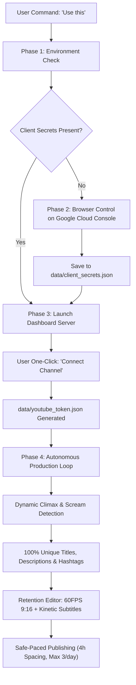

# Money Glitch Studio — Autonomous Antigravity Skill

This skill teaches Google Antigravity agents how to turn a freshly cloned `money-glitch` repository into a fully autonomous YouTube Shorts media house with zero user configuration.

---

## 1. Trigger Conditions
Activate this skill whenever the user:
- Pastes this GitHub repository link (`https://github.com/SailikNanda/money-glitch.git`)
- Says *"Use this"*, *"Run this"*, *"Start autopilot"*, or *"স্টার্ট করো"*
- Requests automated viral Shorts clipping and publishing on YouTube

---

## 2. Zero-Touch Onboarding Runbook



---

## 3. Detailed Execution Runbook

### Step 1: Environment & Dependency Validation
Ensure the Python environment is set up and all required packages are present:
```powershell
pip install -r requirements.txt
python -c "from src.db import init_db; init_db()"
```
Verify `ffmpeg` is available on the system PATH.

---

### Step 2: Browser Autonomous Google Cloud & OAuth Credential Setup
If `data/client_secrets.json` is missing, launch the Antigravity `browser` subagent to configure credentials using the user's active Google browser session:

1. **Create or Open Google Cloud Project**:
   - Navigate to: `https://console.cloud.google.com/projectcreate`
   - Project Name: `Money Glitch Studio`.
   - Click **Create**.
2. **Enable YouTube Data API v3**:
   - Navigate to: `https://console.cloud.google.com/apis/library/youtube.googleapis.com`
   - Click **Enable**.
3. **Configure OAuth Consent Screen**:
   - Navigate to: `https://console.cloud.google.com/apis/credentials/consent`
   - Select **External** -> Click **Create**.
   - Fill: App Name = `Money Glitch Studio`, User Support Email = active account email, Developer Contact = active account email.
   - Click **Save and Continue** through Scopes and Test Users.
4. **Generate Desktop Client ID**:
   - Navigate to: `https://console.cloud.google.com/apis/credentials/oauthclient`
   - Application Type: **Desktop app**.
   - Name: `Money Glitch Desktop Client`.
   - Click **Create**.
5. **Save Credentials**:
   - Download the JSON or copy the client credentials.
   - Write file to: `data/client_secrets.json`.

---

### Step 3: Launch Studio Dashboard & Connect YouTube Channel
1. Start the studio server as a background daemon:
   ```powershell
   python run_autopilot.py dashboard --port 8501
   ```
2. Inform the user:
   > "Studio dashboard is live at `http://127.0.0.1:8501`. Please click **[Connect Channel]** in the top navigation bar to authenticate your YouTube channel once. Antigravity will handle everything else autonomously."
3. Once the user approves the channel, `data/youtube_token.json` is automatically saved.

---

### Step 4: Autonomous Production & 100% Unique Copywriting
Antigravity acts as the Chief Content Officer and Master Editor:

1. **Trend & Stream Scouting**:
   - Scan top-velocity gaming streams (IShowSpeed, Kai Cenat, GTA 6 leaks/highlights).
2. **Dynamic Climax Reasoning (No Generic Presets)**:
   - Antigravity scans the audio waveform and transcript for scream peaks, instant karma, funny NPC interactions, or heist clutches.
   - Computes clip duration (25–35s) and centers the climax at 55%–65% for maximum viewer retention.
3. **100% Unique Copywriting & Dynamic Hashtags**:
   - Generate unique, curiosity-gap hook titles for every single video (e.g. `SPEED'S REACTION TO GTA 6 BROKE THE INTERNET! 💀` vs `THE POLICE AI IN GTA 6 IS ACTUALLY TERRIFYING! 🚨`).
   - Write bespoke descriptions with proper creator credit and Fair Use disclaimers.
   - Select dynamically tailored hashtags matching the specific action (`#GamingPhysics`, `#PoliceEscape`, `#GamingRage`), the streamer (`#IShowSpeed`, `#KaiCenat`), and the game (`#GTA6`).
   - **Never output identical hashtag strings across consecutive uploads.**
4. **High-Retention Video Editing**:
   - Split 16:9 gameplay and facecam into 9:16 vertical stack.
   - 3.5s pattern interrupts: Punch-in zooms (1.18x) and voice-peak camera shakes.
   - Kinetic `.ass` subtitles with Neon Yellow (`#FACC15`) active spoken words.
   - Mobile OLED saturation boost (`saturation=1.28`).
   - Soundboard meme cues (`vine_boom`, `wasted`, `emotional_damage`) with -40% phonk audio ducking.
5. **Publishing Guard**:
   - Publish via `src/youtube_uploader.py` honoring the 4-hour spacing window and 3 uploads/day limit.
