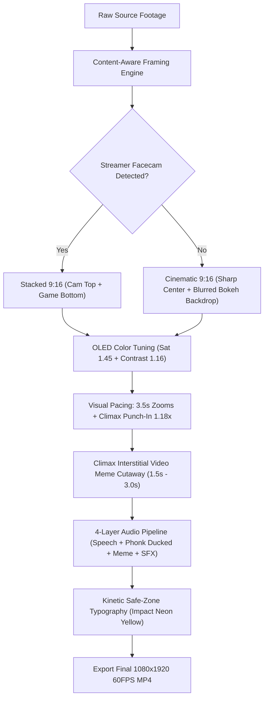

# Viral Short Video Editing Skill

This skill guides Antigravity agents in creating hyper-retention, high-dopamine vertical video edits (1080x1920 @ 60 FPS) engineered specifically for YouTube Shorts, Instagram Reels, and TikTok algorithms.

---

## 1. Core Architectural Pillars



---

## 2. Video Framing & Facecam Detection

Never use crude 50/50 splits or arbitrary cuts. The engine uses OpenCV face detection:

```python
face_cascade = cv2.CascadeClassifier(cv2.data.haarcascades + 'haarcascade_frontalface_default.xml')
gray = cv2.cvtColor(frame, cv2.COLOR_BGR2GRAY)
faces = face_cascade.detectMultiScale(gray, scaleFactor=1.15, minNeighbors=4, minSize=(40, 40))
```

- **If Real Face Detected in Corners**: Generates calibrated facecam panel (`crop=cam_w:cam_h:cam_x:cam_y`) placed at top (`y=60`) with gameplay below (`y=800`).
- **If Pure Gameplay / Cinema / Sports (No Facecam)**: Centers the original footage with golden neon letterbox dividers (`y=640` and `y=1270`) over a blurred dynamic bokeh backdrop (`boxblur=25:5`).

---

## 3. Video Meme Interstitial Cutaways

Replace weak, static sticker badges with **high-dopamine video meme cutaways**:

### Available Video Memes (`assets/memes/`):
| Meme Clip | Duration | Style | Primary Trigger |
| :--- | :--- | :--- | :--- |
| `why_running.mp4` | 2.0s | Full Interstitial Cut | Streamer screaming, police escape, rage |
| `wait_a_minute_cut.mp4` | 2.5s | Full Interstitial Cut | Gameplay glitches, instant karma, unexpected fails |
| `steve_harvey_cut.mp4` | 2.0s | Full Interstitial Cut | Shocked disbelief, hilarious fails |
| `gigachad_cut.mp4` | 2.0s | Full Interstitial Cut | 1v5 clutch, sigma play, impossible win |
| `rock_eyebrow.mp4` | 1.8s | Keyed Chromakey (`colorkey=0x00FF00`) | Suspicious gameplay, hacker moments |
| `walter_fall.mp4` | 2.0s | Keyed Chromakey (`colorkey=0x00FF00`) | Heartbreaking defeat, rage quit |
| `emotional_damage.mp4` | 1.8s | Keyed Chromakey (`colorkey=0x00FF00`) | Brutal roast, instant elimination |

### Implementation in FFmpeg:
```bash
# Full Video Meme Cutaway overlay during [climax_t, climax_t + dur]
[1:v]scale=1080:1920:force_original_aspect_ratio=decrease,pad=1080:1920:(ow-iw)/2:(oh-ih)/2:black[meme_fg];
[v_base][meme_fg]overlay=0:0:enable='between(t,11.0,13.5)'[vout]
```

---

## 4. 4-Layer Dynamic Audio Pipeline

1. **Layer 1: Primary Audio (`0:a`)**: Streamer voice and gameplay audio.
2. **Layer 2: Trending Phonk (`assets/audio/trending_phonk.mp3`)**: Looped continuously and ducked by -50% (`volume=0.20`) under speech so words cut through clearly.
3. **Layer 3: Interstitial Meme Audio**: Synchronized at `climax_t` with boosted dialogue (`volume=2.2`).
4. **Layer 4: Climax SFX**: Vine Boom, Metal Pipe Falling, Bruh, or Taco Bell Bong delayed to `climax_t` (`volume=1.9`).

Combined seamlessly using `amix`:
```bash
[0:a][a_phonk][a_meme][a_sfx]amix=inputs=4:duration=first:dropout_transition=2,aformat=sample_rates=48000:channel_layouts=stereo[aout]
```

---

## 5. Visual Pacing & OLED Color Grading

- **Mobile OLED Vibrancy**:
  ```bash
  eq=saturation=1.45:contrast=1.16:brightness=0.01,unsharp=5:5:0.9:5:5:0.4
  ```
- **3.5s Pattern Interrupt Zoom**:
  Applies subtle micro-zooms (1.15x) every 3.5 seconds to maintain high viewer dopamine.
- **Climax Punch-In Zoom (1.18x)**:
  Zooms in tightly during the scream or action climax to accentuate facial reactions.

---

## 6. Kinetic Safe-Zone Typography

- **Font**: Impact font (`C:/Windows/Fonts/impact.ttf` with Arial fallback).
- **Color**: Neon Yellow (`#FACC15`) with thick black borders (`borderw=5:bordercolor=black`).
- **Auto-Wrap Rule**: If title > 22 characters, cleanly split into 2 lines at the midpoint so text never clips.
- **Safe Zone Rule**:
  - Top Hook Title: `y=20` and `y=80` (well below top UI).
  - Bottom Caption: `y=1740` (well above bottom YouTube Shorts channel title and sound buttons).
  - State Switch: Switches from `"WAIT FOR IT..."` to `"THIS CANNOT BE REAL!"` at the exact climax timestamp.
