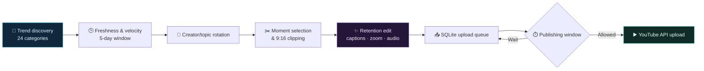

<div align="center">


<br />

<table><tr><td align="center" width="50%"><br /><b>MONEY GLITCH</b><br /><sub>Autonomous Shorts Studio</sub></td><td align="center" width="50%"><br /><b>GOOGLE ANTIGRAVITY</b><br /><sub>AI orchestration</sub></td></tr></table>

# ⚡ MONEY GLITCH
### Discover. Clip. Edit. Publish. Repeat.

**An Antigravity-first automation studio for discovering trending videos, turning eligible footage into vertical Shorts, and managing a paced YouTube publishing queue.**


[**🚀 Quickstart**](#-launch-in-minutes) · [**✨ Features**](#-what-makes-it-different) · [**🧠 Pipeline**](#-from-trend-to-short) · [**🖥️ Dashboard**](#️-studio-control-center) · [**⚙️ Commands**](#️-command-center)

</div>

---

## ✨ What makes it different

| 🔎 DISCOVER | ✂️ CREATE | 🚀 PUBLISH |
|:---|:---|:---|
| Searches **24 trend categories** across gaming, cinema, sports and viral culture. | Crops source material to **9:16**, with kinetic captions, zooms and audio treatment. | Uses YouTube OAuth, a persistent SQLite queue and upload pacing controls. |
| Prioritizes fresh candidates with a **5-day** discovery window. | Targets **1080 × 1920 at 60 FPS** with FFmpeg-based processing. | Configured for **up to 3 uploads/day** with **4-hour spacing**. |
| Rotates creators and topics to reduce repetition. | Uses scene/action peaks to select short-form moments. | Designed to resume queued work after restarts. |

> [!IMPORTANT]
> This repository documents an **automation workflow**, not a guarantee of unattended setup or successful uploads. Google Cloud permissions, OAuth consent, available source rights, API quotas and your machine's configuration can require manual action.

## 🚀 Launch in minutes

**Option A — Google Antigravity workflow**

Paste the repository URL into your Antigravity workspace and ask it to follow the project instructions:

```text
https://github.com/SailikNanda/money-glitch.git
Read AGENTS.md and README.md. Set up this studio, verify each dependency,
and ask for my approval before connecting accounts or publishing.
```

**Option B — Local setup**

```bash
git clone https://github.com/SailikNanda/money-glitch.git
cd money-glitch
python -m pip install -r requirements.txt
python run_autopilot.py dashboard --port 8501
```

Open **http://127.0.0.1:8501** to access the local studio. Install **FFmpeg/ffprobe** and configure YouTube Data API v3 OAuth credentials before attempting uploads. See [AGENTS.md](AGENTS.md) for the Antigravity setup runbook and [.env.example](.env.example) for configuration hints.

> [!NOTE]
> You must authorize your YouTube account. Never commit `data/client_secrets.json`, `data/youtube_token.json` or other credentials.

## 🧠 From trend to Short



### 🌍 Discovery coverage

| Area | Categories | Examples |
|---|---:|---|
| 🎮 Gaming | 8 | Open-world chaos, esports, survival, horror, indie games |
| 🎬 Cinema | 5 | Trailers, action, anime, plot twists, soundtracks |
| 🏆 Sports | 6 | Football, basketball, combat sports, motorsport, stunts |
| ⚡ Viral | 5 | Robotics, animals, unlikely moments, ASMR, street trivia |
| **Total** | **24** | Multi-topic discovery, not locked to a single creator |

### 🎞️ Editing recipe

```text
┌────────────── 9:16 SHORT ──────────────┐
│  FACE CAM / POV                       │
├───────────────────────────────────────┤
│                                       │
│  PRIMARY ACTION / GAMEPLAY            │
│  Zooms + action-aware framing         │
│                                       │
├───────────────────────────────────────┤
│  KINETIC SUBTITLES                    │
│  Yellow active-word emphasis         │
├───────────────────────────────────────┤
│  PLATFORM UI SAFE AREA                │
└───────────────────────────────────────┘
```

The documented editing strategy includes **3.5-second pattern-interrupt zooms**, **1.18× punch-ins**, **ASS subtitles**, saturation/contrast adjustments and music ducking beneath speech. Exact output depends on the source and the available processing pipeline.

## 🖥️ Studio control center

The FastAPI dashboard is the control surface for reviewing discovery, clips, the queue and YouTube connection.

```bash
python run_autopilot.py dashboard --port 8501
```

| Studio area | Purpose |
|---|---|
| 🔎 Scout | Discover and evaluate candidate videos |
| ✂️ Clipper | Produce vertical clips |
| 🎛️ Editing | Add retention-focused visual and audio treatment |
| 🧠 Brain | Coordinate selection and metadata |
| ☁️ Uploader | Manage authorization and publishing queue |

## ⚙️ Command center

| Command | Action |
|---|---|
| `python run_autopilot.py discover` | Discover candidate videos |
| `python run_autopilot.py clip --source video.mp4` | Clip an authorized local source |
| `python run_autopilot.py cycle` | Run one pipeline iteration |
| `python run_autopilot.py daemon` | Run the continuous scheduler while the PC is on |
| `python run_autopilot.py status` | Inspect queue, clips and publishing status |
| `python run_autopilot.py auth-youtube` | Start YouTube OAuth connection |
| `python run_autopilot.py dashboard --port 8501` | Open the studio UI |

### ⏱️ Publishing and persistence

- **Cadence:** up to **3 uploads per day**, with a **4-hour minimum interval** as documented.
- **Queue:** SQLite stores scheduling, history and pipeline state.
- **Lifecycle:** daemon execution requires the host PC to remain on; the persisted queue supports recovery after a restart.
- **Automation:** `scripts/register_antigravity_automation.py` is the repository's Antigravity integration helper.

## 🗂️ Project map

```text
money-glitch/
├── .agents/skills/        # Antigravity workspace instructions
├── assets/                # Studio / Antigravity branding
├── data/                  # Local state and OAuth files (keep private)
├── scripts/               # Setup and automation helpers
├── src/
│   ├── trend_discovery.py
│   ├── clipping_engine.py
│   ├── retention_editor.py
│   ├── scheduler.py
│   ├── youtube_uploader.py
│   └── dashboard.py
├── templates/             # Dashboard UI
├── AGENTS.md              # Agent setup/runbook
├── requirements.txt
└── run_autopilot.py       # CLI entrypoint
```

## 🛡️ Responsible publishing

Only clip and upload material you **own, have permission to reuse, or are otherwise legally entitled to use**. Automated editing, subtitles, attribution or adding effects do **not** automatically grant reuse rights or prevent copyright claims. Review each upload for platform policy compliance and accuracy before publishing.

---

<div align="center">

### ⚡ From discovery to delivery
**One studio. Multiple content verticals. A repeatable Shorts pipeline.**

 &nbsp; 

<sub>Built for Google Antigravity · Python + FFmpeg + YouTube Data API · MIT License</sub>

</div>
