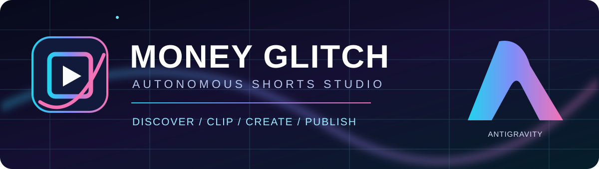
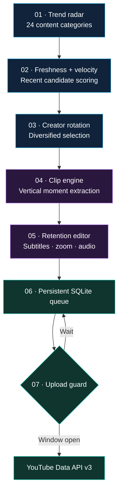

<div align="center">



<br/><br/>


&nbsp;&nbsp;&nbsp;&nbsp;


<br/><br/>

# MONEY GLITCH
### 🌈 THE AUTONOMOUS SHORTS STUDIO

**🔎 FIND THE MOMENT &nbsp; ✂️ SHAPE THE STORY &nbsp; 🚀 SHIP THE SHORT**

A creator-first, Antigravity-powered production pipeline that discovers emerging videos, identifies high-impact moments, edits vertical clips and orchestrates YouTube publishing.

<br/>

[](https://antigravity.google/)
[](requirements.txt)
[](#-publishing-control)
[](LICENSE)

<br/>

[**GET STARTED**](#-get-started) &nbsp; • &nbsp; [**EXPLORE FEATURES**](#-the-creative-engine) &nbsp; • &nbsp; [**SEE THE PIPELINE**](#-how-it-works) &nbsp; • &nbsp; [**OPEN STUDIO**](#-your-studio-control-room)

</div>

---

<div align="center">

## ✨ ONE WORKSPACE. THE ENTIRE SHORT-FORM WORKFLOW.

*From the first spark of a trend to the final scheduled upload.*

</div>

<table>
<tr>
<td width="33%" valign="top" align="center">
<h3>01 / DISCOVER</h3>
<strong>Trend intelligence</strong><br/><br/>
Search across 24 content categories, prioritize fresh momentum and rotate sources to avoid repetitive feeds.
</td>
<td width="33%" valign="top" align="center">
<h3>02 / CREATE</h3>
<strong>Retention-focused editing</strong><br/><br/>
Extract standout moments, reframe to 9:16 and add kinetic subtitles, punch-ins and audio treatment.
</td>
<td width="33%" valign="top" align="center">
<h3>03 / DELIVER</h3>
<strong>Publishing orchestration</strong><br/><br/>
Connect YouTube via OAuth, manage a persistent queue and apply spacing and daily upload limits.
</td>
</tr>
</table>

<div align="center">

| **24** discovery categories | **120h** freshness window | **9:16** vertical video | **60 FPS** target |
|:---:|:---:|:---:|:---:|
| **4h** upload spacing | **3/day** publishing cap | **SQLite** persistence | **FFmpeg** editing |

<sub>Values above describe the repository's documented configuration and targets, not measured performance guarantees.</sub>

</div>

---

## 🎨 The creative engine

### 🔭 Trend radar — built for variety

Money Glitch is designed to look beyond a single creator or genre. Its discovery strategy scores recent candidate videos and rotates content to reduce repetition.

| Content universe | Categories | Examples |
|:---|:---:|:---|
| 🎮 **Gaming & esports** | 8 | Open-world chaos, FPS clutches, survival, horror, indie discoveries |
| 🎬 **Film & entertainment** | 5 | Trailers, action sequences, anime, plot twists, soundtrack moments |
| 🏆 **Sports & adrenaline** | 6 | Football, basketball, combat sports, extreme stunts, motorsport |
| ⚡ **Internet & culture** | 5 | Tech, animals, rare moments, satisfying restoration, street trivia |

> **Freshness-first discovery:** The documented strategy uses a five-day candidate window, view-velocity scoring and a creator/topic rotation policy. These filters help identify relevant material; they do not establish permission to reuse it.

### ✂️ Edit for the vertical screen

<table>
<tr>
<td width="50%" valign="top">

**THE FRAME**

- 1080 × 1920 vertical output target
- Facecam / POV + action-oriented framing
- Subtitle-safe composition
- FFmpeg-based processing

</td>
<td width="50%" valign="top">

**THE FINISH**

- 3.5-second pattern-interrupt cadence
- 1.18× punch-in zoom treatment
- Kinetic ASS captions with highlighted words
- Color enhancement and speech-aware music ducking

</td>
</tr>
</table>

```text
╭────────── VERTICAL SHORT ──────────╮
│                                    │
│          FACE CAM / POV            │
│                                    │
├────────────────────────────────────┤
│                                    │
│          THE MAIN MOMENT           │
│                                    │
│       action · zoom · energy       │
│                                    │
├────────────────────────────────────┤
│        KINETIC CAPTION ZONE        │
├────────────────────────────────────┤
│       PLATFORM-SAFE MARGIN         │
╰────────────────────────────────────╯
```

---

## ⚡ How it works

<div align="center">

**DISCOVER → FILTER → SELECT → CLIP → POLISH → QUEUE → PUBLISH**

</div>



<details>
<summary><b>🧩 Explore the pipeline modules</b></summary>
<br/>

| Module | Responsibility |
|:---|:---|
| `src/trend_discovery.py` | Candidate search and discovery |
| `src/clipping_engine.py` | Moment selection and vertical clipping |
| `src/retention_editor.py` | Video/audio finishing |
| `src/scheduler.py` | Pipeline cadence and scheduling |
| `src/youtube_uploader.py` | YouTube authorization and publishing |
| `src/dashboard.py` | Local web control surface |
| `run_autopilot.py` | Master command-line entrypoint |

</details>

---

## 🚀 Get started

### 01 — Launch with Google Antigravity

Open your Antigravity workspace and paste:

```text
https://github.com/SailikNanda/money-glitch.git

Read README.md and AGENTS.md. Inspect the environment, install the
required dependencies, and guide me through YouTube authorization.
Ask before making account changes or publishing any videos.
```

The [agent runbook](AGENTS.md) describes the intended setup flow, including dependencies, Google Cloud OAuth and automation registration. Browser actions and unattended setup depend on the capabilities and permissions of your Antigravity installation.

### 02 — Or run locally

```bash
git clone https://github.com/SailikNanda/money-glitch.git
cd money-glitch
python -m pip install -r requirements.txt
python run_autopilot.py dashboard --port 8501
```

**Before publishing:** Install `ffmpeg` and `ffprobe`, enable YouTube Data API v3 in Google Cloud, configure a Desktop OAuth client, and authorize your YouTube channel.

<div align="center">

### LOCAL STUDIO URL

**http://127.0.0.1:8501**

<sub>The dashboard is available while the local server is running.</sub>

</div>

---

## 🖥️ Your studio control room

A local FastAPI dashboard provides a central view of the production workflow.

<table>
<tr>
<td width="50%"><strong>🔎 SCOUT</strong><br/>Discover trending candidates</td>
<td width="50%"><strong>✂️ CLIPPER</strong><br/>Prepare vertical video moments</td>
</tr>
<tr>
<td><strong>🎛️ EDITOR</strong><br/>Apply video and audio finishing</td>
<td><strong>🧠 DIRECTOR</strong><br/>Coordinate pipeline decisions</td>
</tr>
<tr>
<td><strong>☁️ UPLOADER</strong><br/>Review queue and publishing</td>
<td><strong>📊 STATUS</strong><br/>Inspect pipeline and stored state</td>
</tr>
</table>

### ⌘ Command palette

```bash
# Start the local dashboard
python run_autopilot.py dashboard --port 8501

# Search for new candidates
python run_autopilot.py discover

# Clip footage you are permitted to use
python run_autopilot.py clip --source video.mp4

# Run one pipeline cycle
python run_autopilot.py cycle

# Start the scheduler while this computer remains on
python run_autopilot.py daemon

# Inspect status and publishing queue
python run_autopilot.py status

# Connect YouTube using OAuth
python run_autopilot.py auth-youtube
```

---

## ⏱ Publishing control

<table>
<tr>
<td width="50%" valign="top">

### Pacing by design

**Up to 3 uploads per day** with a **minimum 4-hour spacing window**, as described in the project's configuration.

</td>
<td width="50%" valign="top">

### Recoverable workflow

**SQLite-backed state** is intended to preserve queue and scheduling data across process restarts.

</td>
</tr>
</table>

> [!NOTE]
> The daemon runs only while its host computer is powered on. The project includes a Windows startup helper and an Antigravity registration script; whether they activate automatically depends on your system configuration.

---

## 🗂 Project structure

```text
money-glitch/
│
├── .agents/skills/          Antigravity workspace skill
├── assets/                  Brand visuals and hero banner
├── data/                    Local SQLite state and credentials
├── scripts/                 Setup and startup helpers
├── src/                     Discovery, clipping, editing, scheduling
├── templates/               Dashboard interface
│
├── AGENTS.md                Automation runbook
├── README.md                You are here
├── requirements.txt         Python dependencies
└── run_autopilot.py          Studio CLI
```

<details>
<summary><b>🔐 Credentials and security notes</b></summary>
<br/>

Use the Google Cloud OAuth flow to authorize YouTube. Keep `data/client_secrets.json`, `data/youtube_token.json`, API keys and any other credentials private. Do not commit secrets to Git. Review account permissions and quota limits before enabling automation.

</details>

<details>
<summary><b>⚖️ Copyright and platform compliance</b></summary>
<br/>

Only publish footage you own, have permission to reuse, or are otherwise legally entitled to use. Cropping, captions, effects and attribution do not automatically create reuse rights or prevent copyright claims. Check YouTube policies and review each clip before publishing.

</details>

---

<div align="center">


&nbsp;&nbsp;&nbsp;&nbsp;


### MADE FOR THE NEXT GENERATION OF SHORT-FORM CREATORS

**DISCOVER MORE. CREATE SMARTER. PUBLISH WITH CONTROL.**

<sub>Money Glitch · Google Antigravity workflow · Python · FFmpeg · YouTube Data API</sub>

<br/><br/>

[**BACK TO TOP ↑**](#money-glitch)

</div>
