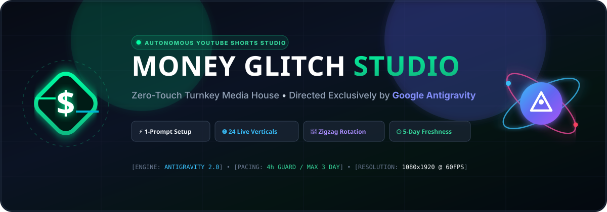
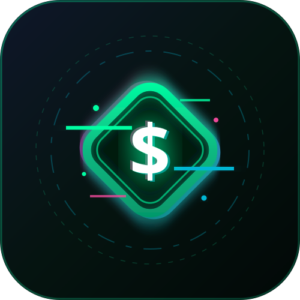
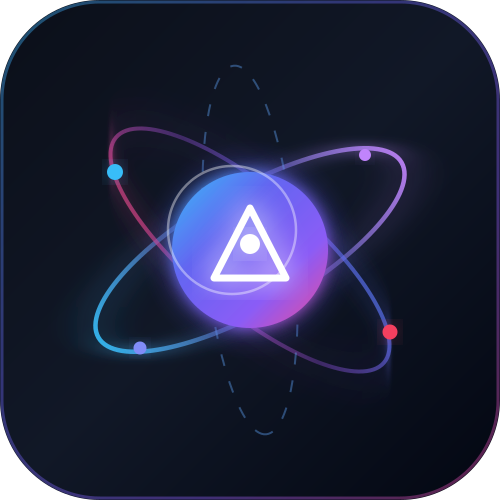
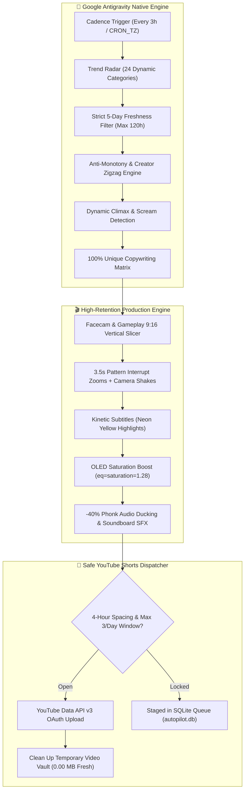

<p align="center">
  
</p>

<p align="center">
  
  &nbsp;&nbsp;&nbsp;&nbsp;&nbsp;&nbsp;
  <a href="https://github.com/google-antigravity"></a>
</p>

<h1 align="center">⚡ Money Glitch Autonomous Studio</h1>

<p align="center">
  <b>The Turnkey 100% Autonomous YouTube Shorts Media House exclusively powered by Google Antigravity.</b><br>
  <i>Universal 24-Category Real-Time Discovery • Anti-Monotony Creator Zigzag • 5-Day Freshness Ceiling • Retention Master Editing</i>
</p>

<p align="center">
  
  
  
  
  
</p>

---

## 🚀 One-Prompt Turnkey Quickstart

No complex manual setup. Simply copy this repository link and paste it into **Google Antigravity**:

```text
https://github.com/SailikNanda/money-glitch.git
Use this
```

### What Google Antigravity Does Automatically:
1. **📦 Auto-Installs & Inits**: Clones the repo, installs Python requirements, checks FFmpeg, and initializes the SQLite database.
2. **🌐 Autonomous Google Cloud Setup**: Takes browser control on Google Cloud Console to enable the `YouTube Data API v3` and downloads the Desktop OAuth client credentials directly to `data/client_secrets.json`.
3. **🖥️ Launches Dashboard & Connects Channel**: Spawns the real-time studio dashboard on `http://127.0.0.1:8501` and prompts you once to link your YouTube channel via Google Sign-In.
4. **⚙️ Registers in Antigravity Automations**: Automatically registers this studio as a permanent background sidecar in your Antigravity **Automations** tab (`~/.gemini/config/sidecars/money-glitch-autopilot/sidecar.json`).
5. **🎬 24/7 Autonomous Production**: Researches real-time trends, applies creator zigzag rotation, generates unique titles/hashtags, performs 60FPS retention edits, and publishes to YouTube Shorts with a 4-hour spacing guard!

---

## 🏗️ System Architecture



---

## 🌐 Universal 24-Category Real-Time Discovery

Rather than being locked to a single creator or topic, Money Glitch continuously discovers real-time breakout trends across **24 diverse verticals**:

| Vertical | Categories & Themes | Typical Clips & Highlights |
| :--- | :--- | :--- |
| **🎮 Gaming (8)** | `Open World Chaos`<br>`FPS & Esports Clutches`<br>`Survival Sandbox Traps`<br>`Horror Jumpscare Screams`<br>`Physics Destruction`<br>`Gamer Rage & Karma`<br>`Souls Boss Fights`<br>`Breakout Indie Games` | GTA 6 leaks, Valorant 1v5 aces, Minecraft redstone traps, Lethal Company screams, BeamNG destruction, broken controllers, Elden Ring clutches. |
| **🎬 Cinema (5)** | `Blockbuster Trailers`<br>`Cinematic Action & Chases`<br>`Viral Anime Fights`<br>`Mind-Bending Plot Twists`<br>`Soundtrack Visual Drops` | Official Hollywood teasers, movie car chase climaxes, 4K 60FPS anime battles, shocking movie endings, epic Hans Zimmer drops. |
| **🏆 Sports (6)** | `NBA Buzzer Beaters`<br>`UFC & Boxing KOs`<br>`Soccer / Football Golazos`<br>`Extreme Red Bull Stunts`<br>`NFL Impossible Catches`<br>`Supercar & F1 Drifts` | 90th-minute game winners, walk-off counter knockouts, bicycle kicks, urban roof parkour, one-handed touchdown grabs, rally slides. |
| **⚡ Viral (5)** | `1-in-a-Million Odds`<br>`Robotics & Tech Leaks`<br>`Clever & Heroic Animals`<br>`Satisfying ASMR Restorations`<br>`Public Street Trivia` | Unbelievable real-life coincidences, humanoid robot reveals, pet rescue feats, hydraulic press crushing, hilarious street questions. |

---

## 🔄 Anti-Monotony & Creator Zigzag Protocol

YouTube audiences habituate quickly if a channel posts the same face or game repeatedly. Money Glitch enforces strict creator diversification:

- **Open to Millions of Creators**: No hardcoded whitelist. Evaluates any YouTube creator whose clip demonstrates high view velocity and authentic entertainment value.
- **Velocity + Exploration Jitter**: Famous and viral trending clips receive priority, while random exploration points (+0 to +15 pts) allow smaller breakout creators to be featured.
- **Max 1 Video Per Channel Per Batch**: Prevents any single channel from dominating discovery results.
- **Universal Zigzag Penalty**: Evaluates the last 5 published uploads. If a creator or category was featured recently, the engine applies a heavy penalty, guaranteeing an alternating sequence:
  $$\text{Creator A (Gaming)} \longrightarrow \text{Blockbuster (Cinema)} \longrightarrow \text{Creator B (Gaming)} \longrightarrow \text{Buzzer Beater (Sports)} \longrightarrow \text{Creator C...}$$

---

## 🕒 Strict 5-Day Freshness Ceiling

Outdated content from weeks or months ago is completely banned by code:
- **`publishedAfter` Gate**: Hardcoded API query parameter `publishedAfter = (now - 5 days)`.
- **120-Hour VPH Filter**: Every candidate's view velocity is evaluated per hour. Videos older than 120 hours (5 days) are automatically rejected.
- **Temporal Search Tags**: All search queries dynamically inject `"this week"`, `"today"`, and `"latest"` qualifiers.

---

## 🎨 High-Retention Video Engineering

Every short is mastered in vertical **1080x1920 @ 60 FPS** following viewer retention psychology:

```
┌──────────────────────────────────────────────┐
│  TOP 15% (0-280px):   Streamer Facecam / POV │
├──────────────────────────────────────────────┤
│                                              │
│  CENTER 60% (280-1450px): High-Octane Action │
│   - 3.5s Pattern Interrupt Zooms (1.18x)     │
│   - Voice Peak Camera Shakes                 │
│                                              │
├──────────────────────────────────────────────┤
│  SUBTITLE ZONE: Kinetic .ASS Neon Yellow     │
├──────────────────────────────────────────────┤
│  BOTTOM 25% (1450-1920px): SAFE UI ZONE      │
│  (YouTube Shorts overlay safe, unobstructed) │
└──────────────────────────────────────────────┘
```

1. **3.5s Pattern Interrupt Cadence**: Alternates between 1.0x wide and 1.18x punch-in zooms to prevent visual habituation.
2. **Kinetic `.ass` Typography**: Uppercase Impact font rendered in the YouTube safe zone with active spoken words highlighted in **Neon Yellow** (`#FACC15`).
3. **Mobile OLED Vibrancy**: Boosts video saturation (`eq=saturation=1.28:contrast=1.06`) and edge sharpness for vibrant smartphone displays.
4. **Smart Sidechain Audio Ducking**: Background phonk/hype music automatically ducks by **-40%** under streamer speech and swells during climactic gameplay drops.

---

## 🖥️ Studio Control Center (FastAPI Dashboard)

Run the real-time glassmorphic control center locally:

```powershell
python run_autopilot.py dashboard --port 8501
```

Access at **`http://127.0.0.1:8501`** to monitor:
- **5 Autonomous Agent Cursors**: Scout, Clipper, Meme VFX, Brain, and Uploader.
- **Multi-Track Live Timeline**: Track 1 through Track 5 real-time scrubbing.
- **Storage Vault Health**: One-click wipe keeping disk space at **0.00 MB**.
- **YouTube Auth Hub**: Direct one-click Google Sign-In and token refresh.

---

## 🔄 Reboot-Safe Continuous Lifecycle

- **PC ON**: Runs continuously in the background (`python run_autopilot.py daemon`).
- **PC OFF**: Shuts down cleanly with zero data corruption. All queue states, published analytics, and 4-hour spacing timers are persisted in SQLite (`data/autopilot.db`).
- **PC BOOT**: Resumes automatically right where it left off.
  *(Optional: Run `scripts\enable_startup.bat` to launch the studio silently on Windows startup).*

---

## 📜 Directory Structure

```text
├── .agents/
│   └── skills/money-glitch-autopilot/   # Antigravity native workspace skill
├── assets/
│   ├── hero-banner.svg                  # Vector GitHub banner
│   ├── money-glitch-logo.svg            # Money Glitch vector emblem
│   └── antigravity-logo.svg             # Google Antigravity vector emblem
├── data/
│   ├── autopilot.db                     # SQLite database (pacing, queue, history)
│   ├── client_secrets.json              # Google Cloud OAuth desktop credentials
│   └── youtube_token.json               # YouTube OAuth token
├── scripts/
│   ├── register_antigravity_automation.py # Native Automations tab injector
│   ├── setup_google_oauth.py            # OAuth credentials validator
│   └── enable_startup.bat               # Windows boot auto-start installer
├── src/
│   ├── ai_generator.py                  # Antigravity Native Director & dynamic copywriting
│   ├── clipping_engine.py               # 9:16 vertical stack & climax slicer
│   ├── config.py                        # 24 categories, 5-day freshness window, quotas
│   ├── dashboard.py                     # FastAPI real-time web server
│   ├── retention_editor.py              # FFmpeg zooms, kinetic .ass, OLED saturation
│   ├── scheduler.py                     # Universal creator zigzag & 4h spacing guard
│   └── trend_discovery.py               # Real-time search & velocity evaluator
├── templates/
│   └── dashboard.html                   # Liquid glass control center UI
├── AGENTS.md                            # Antigravity turnkey agent runbook
├── requirements.txt                     # Python dependencies
└── run_autopilot.py                     # Master CLI entrypoint
```

---

<p align="center">
  <b>Built exclusively for Google Antigravity.</b><br>
  Released under the MIT License • Contributions & PRs Welcome!
</p>
