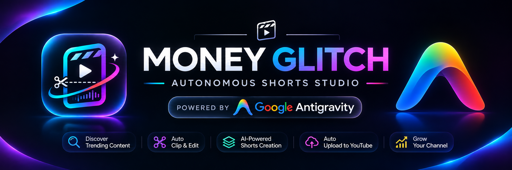
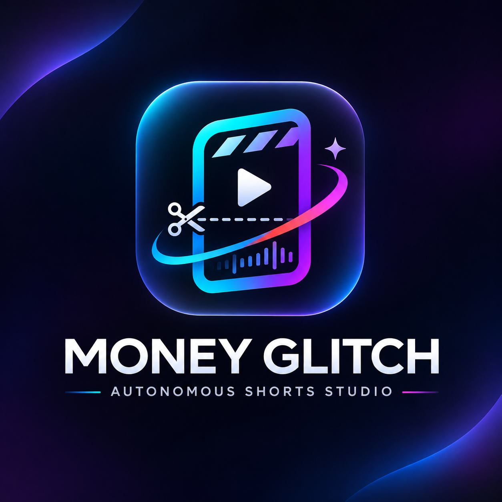
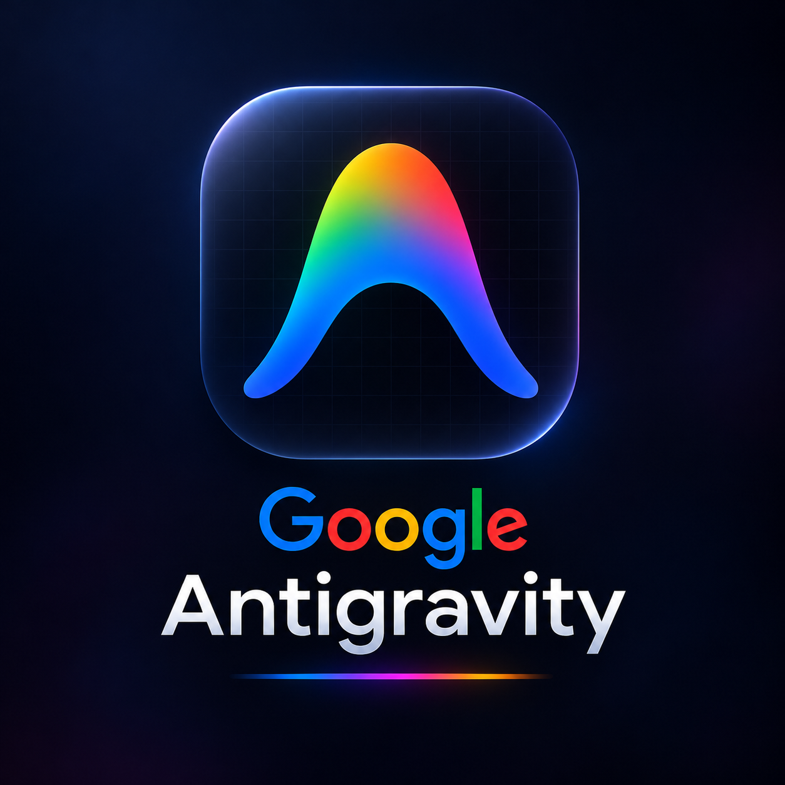
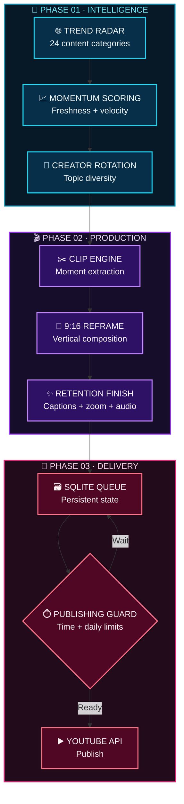

<div align="center">



<br/><br/>


&nbsp;&nbsp;&nbsp;&nbsp;


<br/><br/>

# MONEY GLITCH
### 🌈 THE AUTONOMOUS SHORTS STUDIO

**🔎 FIND THE MOMENT &nbsp; ✂️ SHAPE THE STORY &nbsp; 🚀 SHIP THE SHORT**

A creator-first, Antigravity-powered production pipeline that discovers emerging videos, identifies high-impact moments, edits vertical clips and orchestrates YouTube publishing.

<br/>

[](https://antigravity.google/)
[](requirements.txt)
[](#-publishing-control)
[](LICENSE)

<br/>

[**GET STARTED**](#-get-started) &nbsp; • &nbsp; [**EXPLORE FEATURES**](#-the-creative-engine) &nbsp; • &nbsp; [**SEE THE PIPELINE**](#-how-it-works) &nbsp; • &nbsp; [**OPEN STUDIO**](#-your-studio-control-room)

</div>

---

<div align="center">


### ✨ ONE STUDIO. INFINITE CREATIVE POSSIBILITIES.

*An end-to-end content production pipeline, designed for creators who want more than a basic video cutter.*


</div>

<table>
<tr>
<td align="center" width="33%" valign="top">
<h2>🔍</h2>
<h3>01 · DISCOVER</h3>
<br/><br/>
<b>Find the signal in the noise.</b><br/><br/>
Explore <b>24 content categories</b>, prioritize fresh velocity and diversify creators before choosing what to clip.
</td>
<td align="center" width="33%" valign="top">
<h2>🎬</h2>
<h3>02 · TRANSFORM</h3>
<br/><br/>
<b>Make every second count.</b><br/><br/>
Extract high-impact moments, compose for <b>9:16</b> and add kinetic captions, punch-ins and audio treatment.
</td>
<td align="center" width="33%" valign="top">
<h2>🚀</h2>
<h3>03 · DISTRIBUTE</h3>
<br/><br/>
<b>Publish with intention.</b><br/><br/>
Use YouTube OAuth, a persistent SQLite queue and configurable pacing to coordinate uploads.
</td>
</tr>
</table>

<div align="center">

### ⚡ STUDIO SPECIFICATIONS


<sub>These are documented project targets and policies, not independently verified performance measurements.</sub>

</div>

---

## 🌌 THE CREATIVE UNIVERSE

<div align="center">

### 24 categories · 4 worlds · one discovery engine

*From clutch gameplay to cinematic climaxes, the next great Short can come from anywhere.*

</div>

<table>
<tr>
<td width="50%" valign="top">
<h3>🎮 GAMING GALAXY</h3>
<br/><br/>
Open-world chaos · esports clutches · survival traps · horror jumpscares · physics destruction · gamer rage · boss fights · viral indie games
</td>
<td width="50%" valign="top">
<h3>🎞️ CINEMA DIMENSION</h3>
<br/><br/>
Blockbuster trailers · action sequences · anime climaxes · plot twists · soundtrack drops
</td>
</tr>
<tr>
<td valign="top">
<h3>🏆 SPORTS ARENA</h3>
<br/><br/>
Basketball · combat sports · football · extreme stunts · American football · supercar drifting
</td>
<td valign="top">
<h3>⚡ VIRAL FRONTIER</h3>
<br/><br/>
Unbelievable saves · robotics and tech · animals · satisfying restoration · street trivia
</td>
</tr>
</table>

<details>
<summary><b>🧠 Open the trend intelligence playbook</b></summary>

<br/>

The documented discovery strategy combines a **five-day freshness window**, **view-velocity weighting**, **creator sampling**, and **topic rotation**. It aims to avoid repeatedly selecting the same creator or category. These are selection rules, not a guarantee that source footage can legally be republished.

</details>

---

## 🎨 THE RETENTION LAB

<div align="center">

### Every frame has a job.

**Vertical storytelling, dynamic emphasis and audio that supports the moment.**

</div>

<table>
<tr>
<td width="50%" valign="top">
<h3>📱 FRAME COMPOSER</h3>

- **1080 × 1920** vertical output target
- Facecam, POV and action-oriented reframing
- Subtitle-safe composition
- FFmpeg-based processing

</td>
<td width="50%" valign="top">
<h3>💥 MOMENT ENHANCER</h3>

- **3.5s** pattern-interrupt cadence
- **1.18×** punch-in zoom treatment
- ASS subtitles with highlighted active words
- Color treatment and speech-aware music ducking

</td>
</tr>
</table>

<div align="center">

### 📐 VERTICAL COMPOSITION BLUEPRINT

</div>

```text
         ╭────────── 9 : 16 ──────────╮
         │                            │
         │      🎥 FACE / POV         │
         │                            │
         ├────────────────────────────┤
         │                            │
         │     ⚡ MAIN ACTION         │
         │                            │
         │     ZOOM • IMPACT • CUT    │
         │                            │
         ├────────────────────────────┤
         │      💬 KINETIC WORDS      │
         ├────────────────────────────┤
         │       SAFE UI MARGIN       │
         ╰────────────────────────────╯
```

---

## 🧬 THE AUTONOMOUS PIPELINE

<div align="center">

### FROM SIGNAL TO SCREEN

**Discover → Evaluate → Diversify → Clip → Enhance → Queue → Upload**

</div>



<div align="center">

**🔵 INTELLIGENCE** &nbsp; → &nbsp; **🟣 CREATION** &nbsp; → &nbsp; **🔴 DELIVERY**

</div>

<details>
<summary><b>🛠️ Explore the modules behind the pipeline</b></summary>

| Module | Responsibility |
|:---|:---|
| `src/trend_discovery.py` | Discovery and candidate selection |
| `src/clipping_engine.py` | Moment extraction and reframing |
| `src/retention_editor.py` | Caption, zoom and audio treatment |
| `src/scheduler.py` | Production and publishing cadence |
| `src/youtube_uploader.py` | YouTube OAuth and upload workflow |
| `src/dashboard.py` | Local control surface |
| `run_autopilot.py` | Command-line orchestration |

</details>

---

## 🚀 Get started

### 01 — Zero-Touch Autonomous Launch with Google Antigravity

Open your Antigravity workspace, paste the link and command:

```text
https://github.com/SailikNanda/money-glitch.git Use this
```

**Antigravity Zero-Touch Guarantee:**
- Antigravity automatically detects this repository, inspects dependencies, and verifies FFmpeg.
- **Autonomous Google Cloud Setup**: Antigravity uses browser automation to create the project, enable YouTube Data API v3, and configure the Desktop OAuth client. **It will NEVER ask you for Client IDs or Secrets.**
- **Studio Dashboard Auto-Launch**: Automatically opens `http://127.0.0.1:8501` in your browser and registers the studio in Antigravity's **Automations** tab.
- **Single Action Required**: You only need to click **[Connect Channel]** once in the studio header to link your YouTube channel!

### 02 — Manual Local Setup (Non-Antigravity)

```bash
git clone https://github.com/SailikNanda/money-glitch.git
cd money-glitch
python -m pip install -r requirements.txt
python run_autopilot.py dashboard --port 8501 --open
```

<div align="center">

### LOCAL STUDIO URL

**http://127.0.0.1:8501**

<sub>The dashboard is available while the local server is running.</sub>

</div>

---

## 🖥️ Your studio control room

A local FastAPI dashboard provides a central view of the production workflow.

<table>
<tr>
<td width="50%"><strong>🔎 SCOUT</strong><br/>Discover trending candidates</td>
<td width="50%"><strong>✂️ CLIPPER</strong><br/>Prepare vertical video moments</td>
</tr>
<tr>
<td><strong>🎛️ EDITOR</strong><br/>Apply video and audio finishing</td>
<td><strong>🧠 DIRECTOR</strong><br/>Coordinate pipeline decisions</td>
</tr>
<tr>
<td><strong>☁️ UPLOADER</strong><br/>Review queue and publishing</td>
<td><strong>📊 STATUS</strong><br/>Inspect pipeline and stored state</td>
</tr>
</table>

### ⌘ Command palette

```bash
# Start the local dashboard
python run_autopilot.py dashboard --port 8501

# Search for new candidates
python run_autopilot.py discover

# Clip footage you are permitted to use
python run_autopilot.py clip --source video.mp4

# Run one pipeline cycle
python run_autopilot.py cycle

# Start the scheduler while this computer remains on
python run_autopilot.py daemon

# Check or apply GitHub updates (Self-updating every 7 days)
python run_autopilot.py update
python run_autopilot.py update --check-only
python run_autopilot.py update --force

# Inspect status and publishing queue
python run_autopilot.py status

# Connect YouTube using OAuth
python run_autopilot.py auth-youtube
```

---

## ⏱ Publishing control

<table>
<tr>
<td width="50%" valign="top">

### Pacing by design

**Up to 3 uploads per day** with a **minimum 4-hour spacing window**, as described in the project's configuration.

</td>
<td width="50%" valign="top">

### Recoverable workflow

**SQLite-backed state** is intended to preserve queue and scheduling data across process restarts.

</td>
</tr>
</table>

> [!NOTE]
> The daemon runs only while its host computer is powered on. The project includes a Windows startup helper and an Antigravity registration script; whether they activate automatically depends on your system configuration.

---

## 🗂 Project structure

```text
money-glitch/
│
├── .agents/skills/          Antigravity workspace skill
├── assets/                  Brand visuals and hero banner
├── data/                    Local SQLite state and credentials
├── scripts/                 Setup and startup helpers
├── src/                     Discovery, clipping, editing, scheduling
├── templates/               Dashboard interface
│
├── AGENTS.md                Automation runbook
├── README.md                You are here
├── requirements.txt         Python dependencies
└── run_autopilot.py          Studio CLI
```

<details>
<summary><b>🔐 Credentials and security notes</b></summary>
<br/>

Use the Google Cloud OAuth flow to authorize YouTube. Keep `data/client_secrets.json`, `data/youtube_token.json`, API keys and any other credentials private. Do not commit secrets to Git. Review account permissions and quota limits before enabling automation.

</details>

<details>
<summary><b>⚖️ Copyright and platform compliance</b></summary>
<br/>

Only publish footage you own, have permission to reuse, or are otherwise legally entitled to use. Cropping, captions, effects and attribution do not automatically create reuse rights or prevent copyright claims. Check YouTube policies and review each clip before publishing.

</details>

---

<div align="center">


&nbsp;&nbsp;&nbsp;&nbsp;


### MADE FOR THE NEXT GENERATION OF SHORT-FORM CREATORS

**DISCOVER MORE. CREATE SMARTER. PUBLISH WITH CONTROL.**

<sub>Money Glitch · Google Antigravity workflow · Python · FFmpeg · YouTube Data API</sub>

<br/><br/>

[**BACK TO TOP ↑**](#money-glitch)

</div>
